# Aglomera: simulación de evacuación de multitudes

**Informe de la Fase 1 (entrega parcial)**

Materia: Sistemas de la Industria 4.0, UTN FRLP

Autoría: Mora Resguar · Octubre de 2026

Repositorio: <https://github.com/moragentil/aglomera>

## 1. Objetivo y alcance

El proyecto simula la evacuación de una multitud dentro de un recinto (tipo
estadio o recital) para **detectar puntos de aglomeración** y **comparar
configuraciones de salidas de emergencia**, sin necesitar un recinto real.
Además permite explorar cómo cambian los resultados cuando la gente se empuja,
se desvía o entra en pánico.

El proyecto se apoya en los tres pilares de la materia:

| Pilar | Estado en esta fase |
|---|---|
| Simulación | **Hecho.** Modelo basado en agentes (Mesa) y visualizador interactivo (Solara). |
| Big Data y análisis | **Hecho.** Corridas Monte Carlo que generan CSV, analizados con Pandas. |
| IoT | **Propuesta de arquitectura**, no implementada (ver `docs/iot.md`). |

Esta entrega presenta lo que ya funciona. La Fase 2 (sección 8) suma la
definición del recinto por parte del usuario y el material para la defensa.

## 2. Cómo funciona el modelo

El recinto es una grilla 2D donde cada celda admite una sola persona y puede
ser piso, muro o salida. Es un **autómata celular**: reglas simples y locales
de las que emergen comportamientos colectivos (colas, arqueo en las puertas)
que no están programados de forma explícita.

**Floor field.** Antes de empezar se calcula, una sola vez, la distancia de
cada celda a la salida más cercana (búsqueda en anchura desde todas las
salidas, siguiendo a Blue y Adler, 2001). Es el "mapa" que cada peatón consulta
para saber hacia dónde avanzar. Mide distancia, no congestión: la congestión
aparece recién cuando varios peatones compiten por la misma celda.

**Un paso de la simulación** tiene tres fases, y la separación entre ellas es
lo que hace posible que haya conflictos reales:

| Fase | Qué ocurre |
|---|---|
| 1. Evacuar | Quien está parado en una salida se va y libera la celda. |
| 2. Decidir | Cada peatón activo elige a qué celda querría moverse, todos mirando la misma foto del mundo. |
| 3. Resolver | Si dos o más peatones quieren la misma celda, hay un conflicto: con probabilidad `probabilidad_friccion` nadie se mueve; si no, gana uno al azar y el resto queda **bloqueado**. |

Si cada peatón se moviera apenas decide (activación asincrónica), el segundo
ya vería la celda ocupada y nunca habría un conflicto real. El detalle, con
diagramas, está en `docs/arquitectura.md`.

**Parámetros que modifican el comportamiento:**

- **Fricción** (Kirchner y Schadschneider): probabilidad de que un conflicto por
  una celda deje a todos los pretendientes quietos. Representa roce y empujones.
  Solo se tira cuando hay un conflicto real.
- **Agresividad:** un peatón agresivo no espera: si su mejor celda está
  ocupada, se desvía a cualquier vecina libre.
- **Pánico / manada** (Helbing, Farkas y Vicsek, 2000): en cada paso, con cierta
  probabilidad, un peatón ignora la salida y sigue al centro de la multitud
  cercana (radio de 3 celdas).
- **Vecindad:** 4 direcciones (Von Neumann) u 8 con diagonales (Moore).

**Reproducibilidad.** Todo el azar sale de una semilla (`rng`). Con la misma
semilla la simulación se repite idéntica, lo que permite comparar
configuraciones de forma controlada. Para medir cuánto depende un resultado del
azar, cada escenario se repite con varias semillas.

## 3. Visualizador interactivo

La app se abre con `venv/bin/solara run app.py` y tiene controles de play, paso a
paso y reinicio, más sliders para la cantidad de peatones, la agresividad, la
fricción y el pánico. El escenario por defecto es una sala de 15x10 partida por
una pared con una única puerta de una celda, con 40 peatones.

Convenciones de color: peatón libre en azul, **bloqueado en rojo** (quería
avanzar y no pudo), salida en verde, muros en negro. Un peatón elegido al azar
se marca con un círculo violeta y su recorrido.

Las capturas siguientes se generaron con el mismo código de dibujo que usa la
app (`src/visualization.py`) y la misma configuración del escenario por defecto.

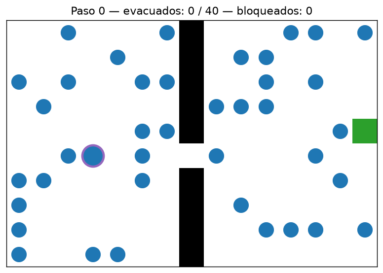

*Figura 1. Estado inicial. Todos los peatones están libres.*

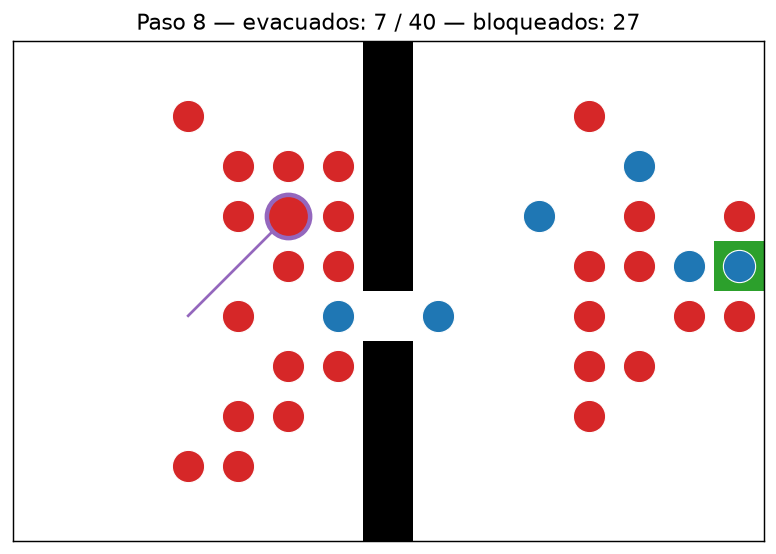

*Figura 2. Paso 8, sin fricción ni pánico: 27 de los 33 peatones que siguen
dentro están bloqueados. La puerta de una celda genera el arqueo que describe la
literatura. El peatón seguido (círculo violeta) lleva varios pasos sin poder
avanzar.*

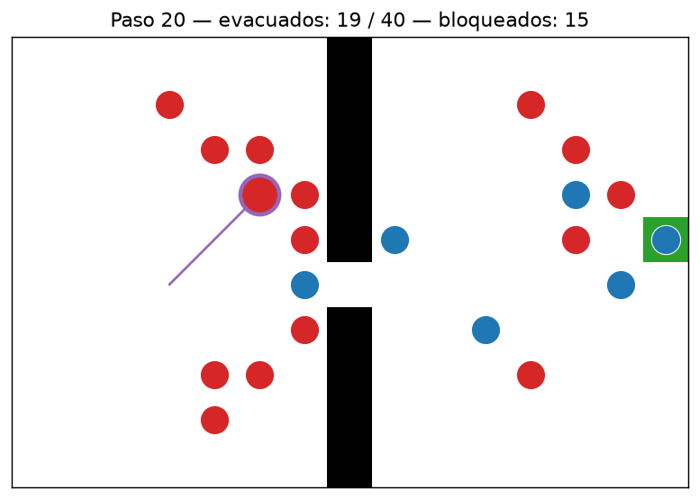

*Figura 3. Paso 20: ya evacuaron 19 de 40 y la cantidad de bloqueados bajó a 15.*

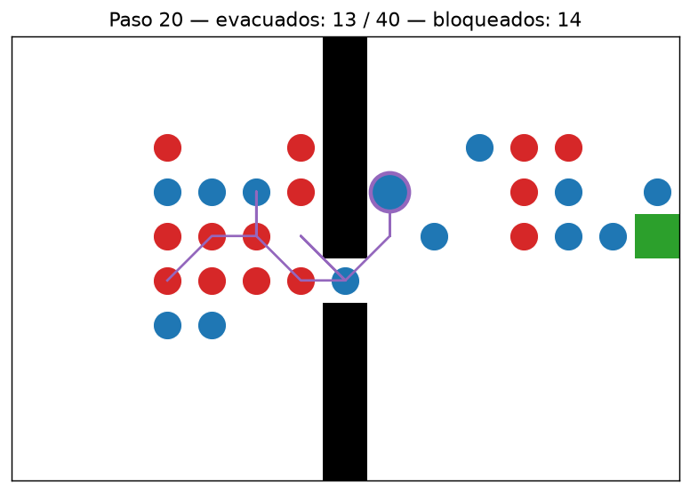

*Figura 4. Mismo escenario y mismo paso con probabilidad de pánico 0.6: parte de
la gente se mueve siguiendo a otros en vez de ir hacia la puerta.*

Con la configuración por defecto (vecindad Moore, semilla 1), el tiempo que tarda
en evacuar toda la sala es de **49 pasos** sin fricción, **88** con fricción 0.6 y
**108** con pánico 0.6.

## 4. Experimentos (Big Data y análisis)

Cada comparación es un experimento con nombre en `experiments/run_batch.py`,
que repite el escenario con varias semillas y guarda el historial completo, paso
por paso, en un CSV. Todo se regenera con un comando:

```bash
venv/bin/python experiments/run_batch.py          # corre los cuatro experimentos
venv/bin/python experiments/run_batch.py --listar # muestra cuáles hay
```

Los CSV se analizan en `notebooks/analisis_resultados.ipynb` con Pandas
(resumen por corrida, promedio y desvío, curvas de evacuación). En los
resultados, "pasos" es la unidad del modelo: no tiene una equivalencia
calibrada en segundos.

### 4.1 Una salida contra dos

Sala abierta de 20x15, con una salida central o dos en los extremos, 10 semillas.

| Agentes | 1 salida | 2 salidas |
|---|---|---|
| 30 | 40.9 pasos | 28.1 pasos |
| 60 | 74.2 pasos | 45.5 pasos |
| 90 | 104.9 pasos | 62.3 pasos |

El desvío entre semillas fue de 1 a 4 pasos, así que la diferencia es real, y la
ventaja de la segunda salida **crece con la cantidad de gente**.

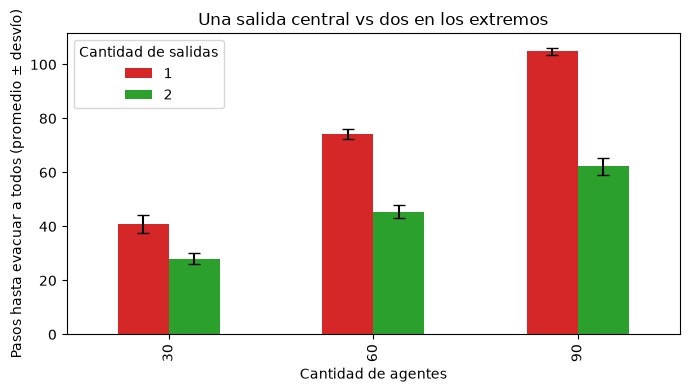

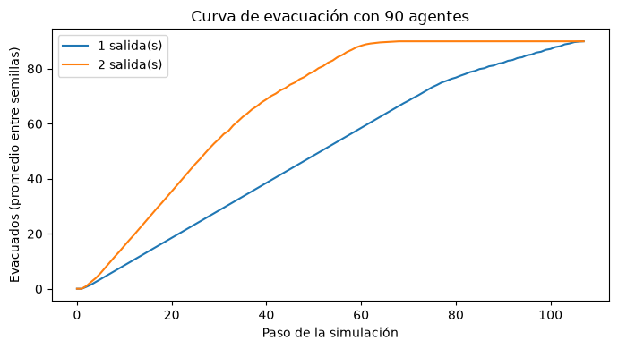

### 4.2 Fricción

Sala con puerta, 100 agentes, 15 semillas.

| Fricción | Pasos para evacuar | Máximo de bloqueados a la vez |
|---|---|---|
| 0.0 | 144.1 | 86.1 |
| 0.3 | 176.0 | 90.5 |
| 0.6 | 243.2 | 92.7 |

A más interferencia física, la evacuación es más lenta y la congestión máxima
también sube.

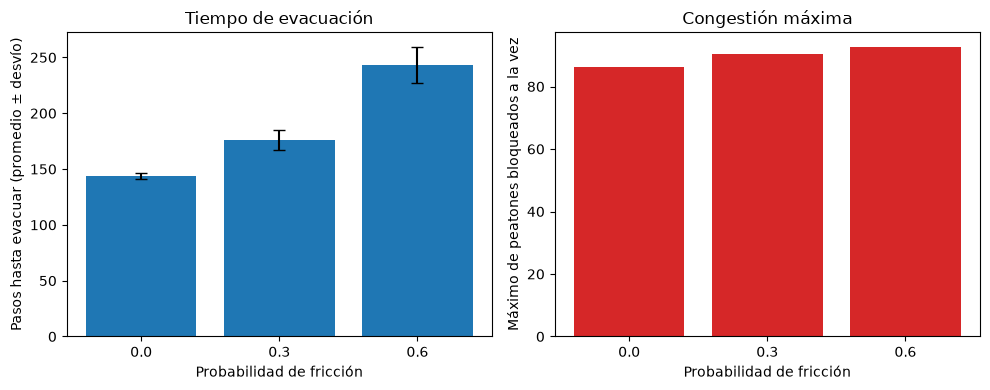

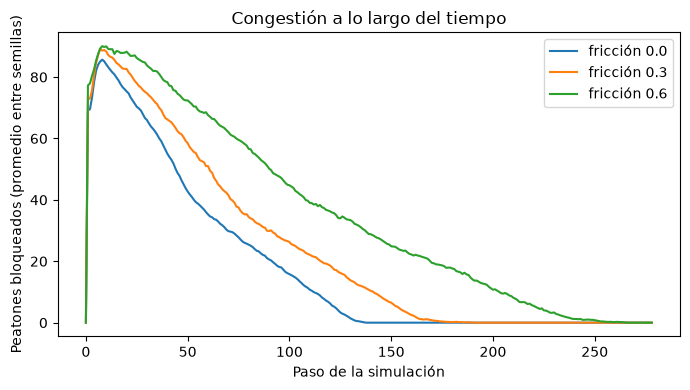

### 4.3 Vecindad: 4 direcciones contra 8

Misma sala con puerta, 100 agentes, 15 semillas.

| Vecindad | Pasos para evacuar | Máximo de bloqueados |
|---|---|---|
| Von Neumann (4) | 144.1 | 86.1 |
| Moore (8, con diagonales) | 113.0 | 88.1 |

Las diagonales aceleran el tránsito (un 22% menos de pasos) pero **no reducen la
congestión en la puerta**: sigue siendo un cuello de botella de una celda, así
que la gente solo llega antes a formar la cola.

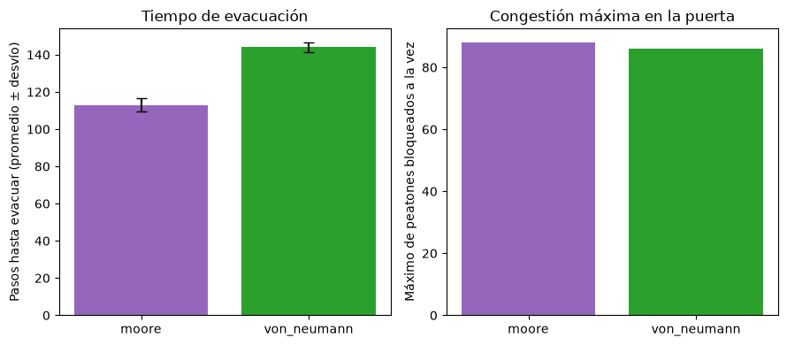

### 4.4 Pánico

Sala abierta con una salida en cada extremo, 80 agentes, 20 semillas.

| Probabilidad de pánico | Pasos para evacuar |
|---|---|
| 0.0 | 50.1 |
| 0.2 | 50.4 |
| 0.4 | 63.0 |
| 0.6 | 106.8 |
| 0.8 | 229.2 (más de 4 veces la base) |
| 1.0 | **No termina** en ninguna de las 20 corridas |

Con pánico total (ningún momento de lucidez) grupos chicos de peatones se
persiguen entre sí y nunca cruzan la salida: en promedio solo unos 7 de 80
logran salir. Lo tomamos como un hallazgo y no como un error; por eso el slider
de la app tiene tope en 0.9.

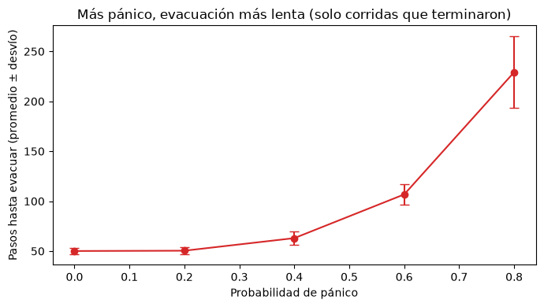

Con la métrica de uso por salida surgió algo que contradijo la hipótesis
inicial: **el pánico no desbalancea las salidas**. La gente se reparte casi
parejo entre las dos (unos 39 y 41 de 80) con cualquier nivel de pánico. La
evacuación se enlentece porque se pierde tiempo siguiendo a otros, no porque
todos se amontonen en una sola puerta.

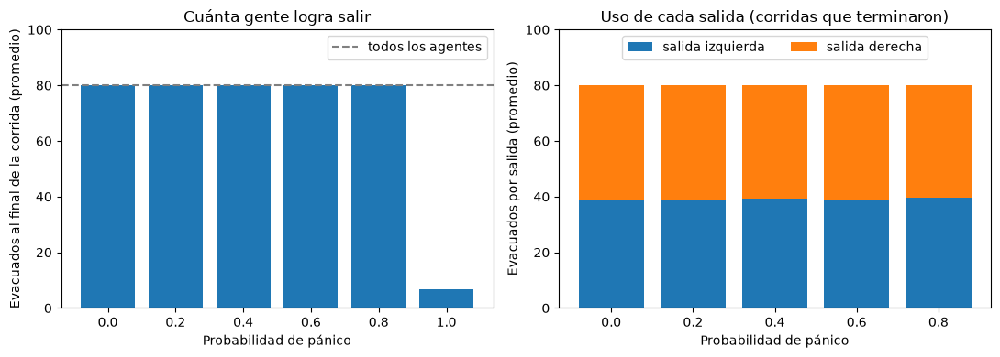

## 5. Lo que no salió como esperábamos

- **El primer intento de "faster is slower" falló.** Con turnos secuenciales, una
  población impaciente evacuaba *más rápido* (por ejemplo 188.3 contra 194.7
  pasos con 130 agentes), porque el orden de turnos ya resuelve de antemano
  cualquier disputa por una celda. Eso llevó a rediseñar el modelo con
  activación sincrónica y fricción, que es el mecanismo que señala la
  literatura.
- **La combinación agresividad x fricción no mostró una paradoja limpia.** Los
  conflictos que genera la agresividad ocurren lejos de la puerta, que es el
  cuello de botella que limita el flujo. Queda abierto para otras geometrías.
- **El pánico tuvo un bug real.** Como etiqueta fija por peatón, dos peatones en
  pánico cerca de una salida se perseguían en círculo y la simulación no
  terminaba. Se corrigió sorteando el pánico en cada paso y se dejó un test de
  regresión.

## 6. Calidad del código

- **32 tests automáticos** (`pytest tests/`) que cubren el espacio, el peatón, el
  modelo y los experimentos.
- Resultados reproducibles: semillas fijas y experimentos con nombre.
- Módulos con una sola responsabilidad: `space.py` (mapa), `agent.py` (decisión
  de un peatón), `model.py` (paso, conflictos y métricas), `visualization.py`
  (dibujo) y `experiments/run_batch.py` (corridas en masa).
- Documentación en `docs/`: marco teórico, arquitectura con diagramas, propuesta
  de IoT y guion de la defensa.

## 7. Limitaciones actuales

- Una celda es una persona, y un paso no tiene duración calibrada: el modelo sirve
  para **comparar configuraciones**, no para predecir tiempos reales.
- No está validado contra datos de evacuaciones reales.
- El recinto está fijo en el código (`app.py`): para probar otra geometría hay
  que editar el archivo.
- IoT es solo una propuesta de arquitectura.

## 8. Fase 2: qué sigue

| Prioridad | Tarea |
|---|---|
| Alta | **Recinto definido por el usuario:** leer el plano desde un archivo de texto (con `#` muro, `S` salida y `.` piso) o JSON, y que el modelo se adapte. Hoy el recinto es fijo. |
| Alta | Escenario de dos salidas en la app, para mostrar el pánico en vivo. |
| Alta | Material de respaldo para la defensa: GIF o grabación de la simulación, por si falla la demo en vivo. |
| Media | Editor visual de planos (grilla clickeable en Solara) que exporte al mismo formato. |
| Media | Selector de vecindad en la interfaz y tests para `visualization.py`. |
| Baja | Velocidad heterogénea real (niños, adultos mayores), dashboard con Streamlit, importar un plano como imagen (opcional) y simular datos de sensores para el pilar IoT. |

La presentación final está prevista para noviembre de 2026.

## Referencias

- Helbing, D., Farkas, I. y Vicsek, T. (2000). *Simulating dynamical features of
  escape panic.* Nature, 407.
- Blue, V. J. y Adler, J. L. (2001). *Cellular automata microsimulation for
  modeling bi-directional pedestrian walkways.* Transportation Research Part B.
- Kirchner, A., Nishinari, K. y Schadschneider, A. (2003). *Friction effects and
  clogging in a cellular automaton model for pedestrian dynamics.* Physical
  Review E, 67.
- Helbing, D. y Molnár, P. (1995). *Social force model for pedestrian dynamics.*
  Physical Review E, 51.

Las referencias están citadas de memoria y conviene verificar volumen y páginas
antes de la entrega final (ver también `docs/marco_teorico.md`).
