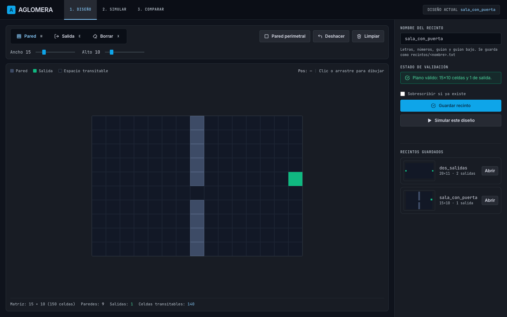
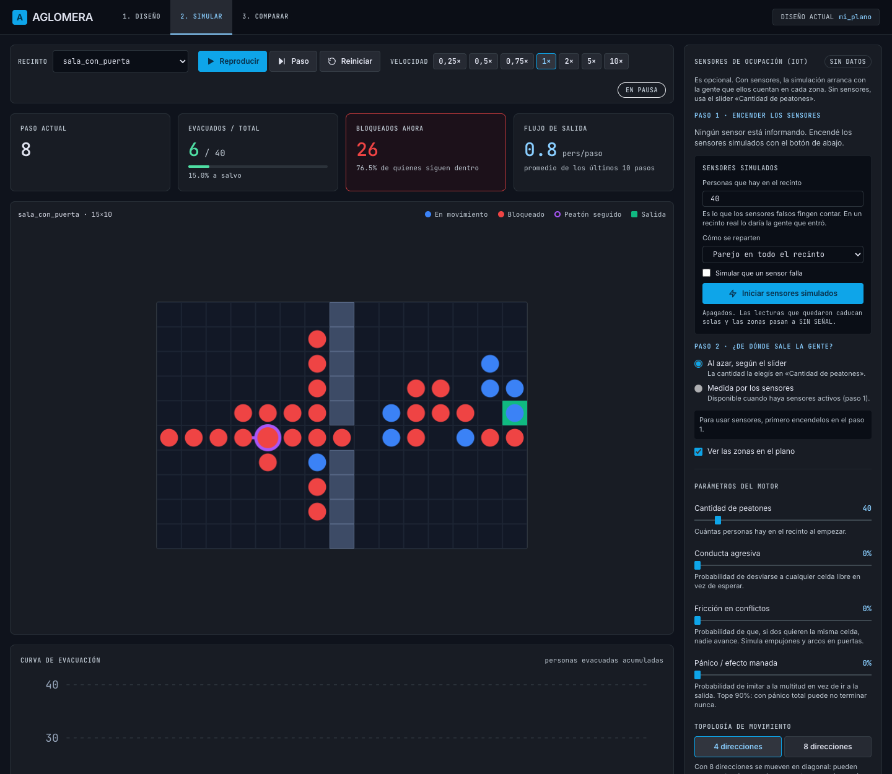
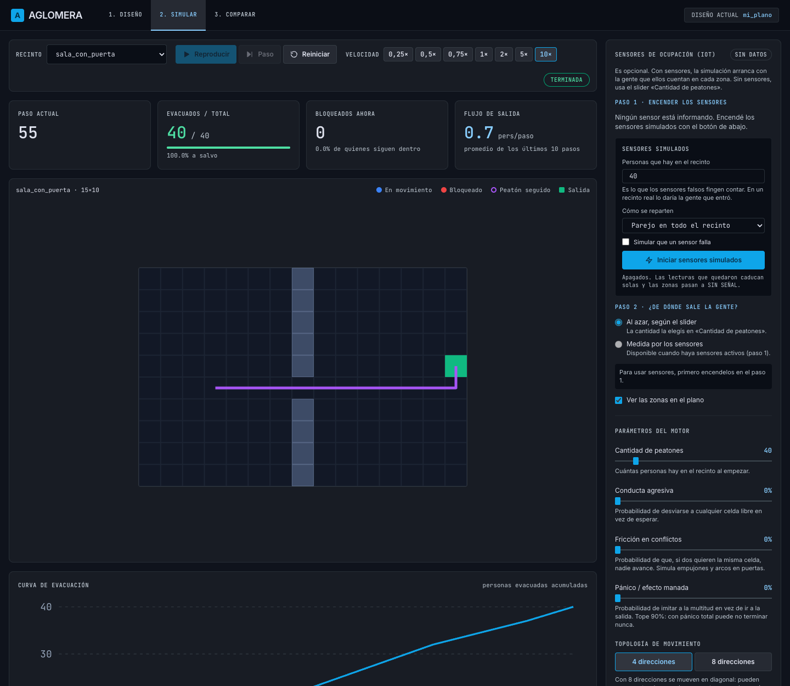
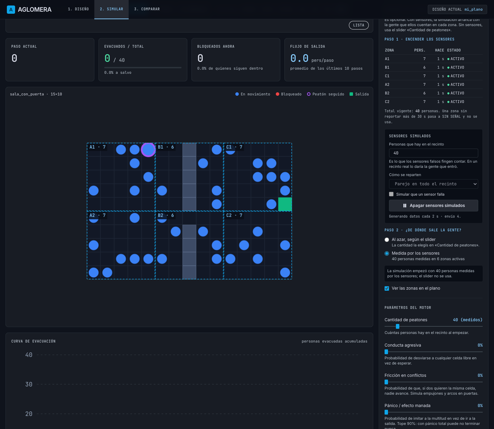
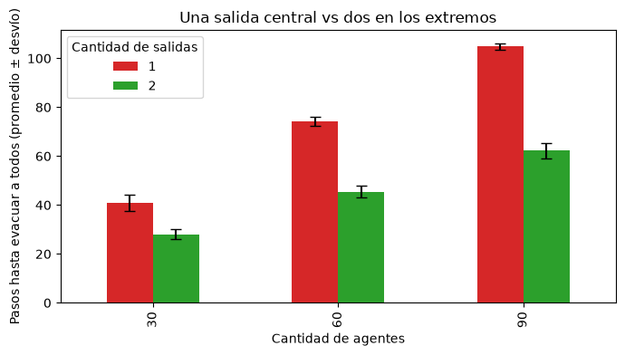
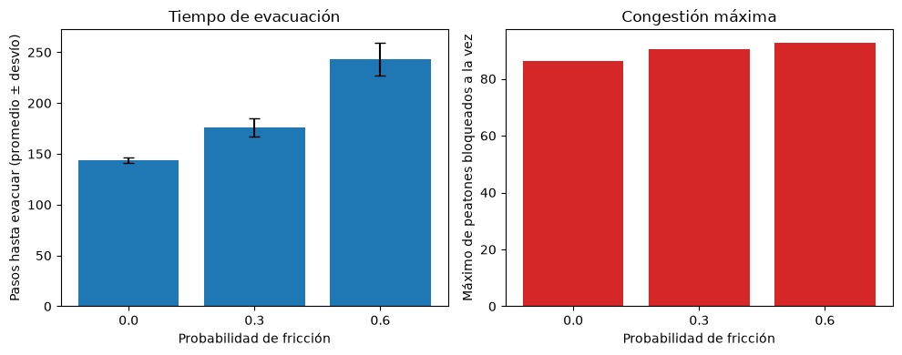
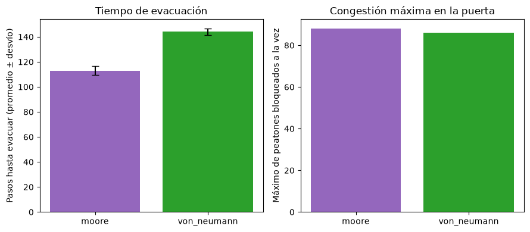
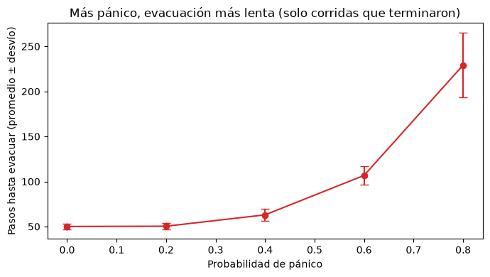
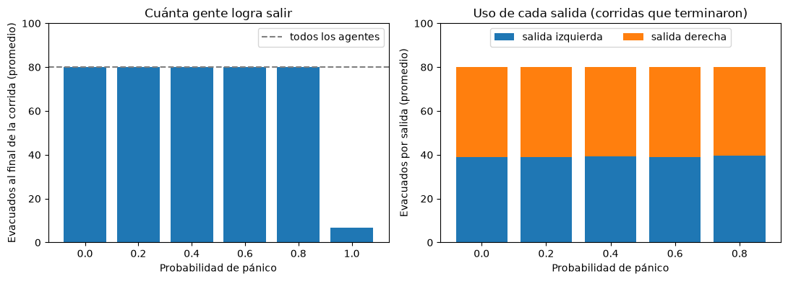

# Aglomera: simulación de evacuación de multitudes

**Informe final**

Materia: Sistemas de la Industria 4.0, UTN FRLP

Autoría: Mora Resguar · Noviembre de 2026

Repositorio: <https://github.com/moragentil/aglomera>

## 1. Objetivo y alcance

El proyecto simula la evacuación de una multitud dentro de un recinto (tipo
estadio o recital) para **detectar puntos de aglomeración** y **comparar
configuraciones de salidas de emergencia**, sin necesitar un recinto real.
Además permite explorar cómo cambian los resultados cuando la gente se empuja,
se desvía o entra en pánico.

Se apoya en los tres pilares de la materia, y los tres tienen hoy una
implementación que se puede ejecutar:

| Pilar | Qué se hizo |
|---|---|
| Simulación | Modelo basado en agentes (Mesa) sobre una grilla, y una **app web propia** para diseñar el recinto, simularlo y compararlo con otros. |
| Big Data y análisis | Corridas Monte Carlo reproducibles que generan CSV, analizados con Pandas, y una pestaña de comparación en la app que repite cada recinto con varias semillas. |
| IoT | **Prototipo con sensores simulados**: conteos de personas por zona que llegan a la API y que la simulación usa como punto de partida. Los sensores físicos y el protocolo MQTT quedan como propuesta. |

## 2. Cómo está armado

| Pieza | Para qué sirve | Dónde está |
|---|---|---|
| Modelo | Grilla, peatones, reglas de movimiento, conflictos y métricas. | `src/` |
| App web | Diseñar, simular y comparar recintos desde el navegador (FastAPI y un frontend propio). | `web/` |
| Recintos | Planos guardados como texto o dibujados como imagen. | `recintos/` |
| Experimentos | Corridas en masa con semillas fijas, guardadas en CSV. | `experiments/`, `notebooks/` |
| Sensores | Zonas del recinto, ingesta de lecturas y sensores simulados. | `src/zonas.py`, `web/sensores.py`, `iot/` |

Una regla de diseño se mantuvo en todo el proyecto: cada módulo conoce solo al
que tiene debajo. El modelo no sabe nada de la web, y la web no reimplementa
reglas del modelo: le pide los resultados. El detalle, con diagramas, está en
`docs/arquitectura.md`.

## 3. Cómo funciona el modelo

El recinto es una grilla 2D donde cada celda admite una sola persona y puede
ser piso, muro o salida. Es un **autómata celular** (Blue y Adler, 2001):
reglas simples y locales de las que emergen comportamientos colectivos (colas,
arqueo en las puertas) que no están programados de forma explícita.

**Floor field.** Antes de empezar se calcula, una sola vez, la distancia de cada
celda a la salida más cercana (búsqueda en anchura desde todas las salidas). Es
la idea del *floor field* de Burstedde et al. (2001): un "mapa" estático que
cada peatón consulta para saber hacia dónde avanzar, en vez de calcular un
camino por persona en cada paso. Mide distancia, no congestión: la congestión
aparece recién cuando varios peatones compiten por la misma celda.

**Un paso de la simulación** tiene tres fases, y la separación entre ellas es lo
que hace posible que haya conflictos reales:

| Fase | Qué ocurre |
|---|---|
| 1. Evacuar | Quien está parado en una salida se va y libera la celda. |
| 2. Decidir | Cada peatón activo elige a qué celda querría moverse, todos mirando la misma foto del mundo. |
| 3. Resolver | Si dos o más peatones quieren la misma celda, hay un conflicto: con probabilidad `probabilidad_friccion` nadie se mueve; si no, gana uno al azar y el resto queda **bloqueado**. |

Si cada peatón se moviera apenas decide (activación asincrónica), el segundo ya
vería la celda ocupada y nunca habría un conflicto real. Esa fue una de las
lecciones del proyecto (sección 7).

**Parámetros que modifican el comportamiento:**

- **Fricción** (Kirchner, Nishinari y Schadschneider, 2003): probabilidad de que
  un conflicto por una celda deje a todos los pretendientes quietos. Representa
  roce y empujones. Solo se tira cuando hay un conflicto real.
- **Agresividad:** un peatón agresivo no espera: si su mejor celda está ocupada,
  se desvía a cualquier vecina libre.
- **Pánico / manada** (Helbing, Farkas y Vicsek, 2000): en cada paso, con cierta
  probabilidad, un peatón ignora la salida y sigue al centro de la multitud
  cercana (radio de 3 celdas).
- **Vecindad:** 4 direcciones (Von Neumann) u 8 con diagonales (Moore).

**Reproducibilidad.** Todo el azar sale de una semilla. Con la misma semilla la
simulación se repite idéntica, lo que permite comparar configuraciones de forma
controlada. Para medir cuánto depende un resultado del azar, cada escenario se
repite con varias semillas.

## 4. La aplicación web

Se levanta con `venv/bin/uvicorn web.app:app --port 8000` y funciona sin
conexión, porque las librerías y las fuentes están dentro del proyecto. Tiene tres
pantallas.

### 4.1 Diseño

Un editor de planos: se pinta con clic o arrastre (pared, salida y borrar), con
validación en vivo. Sin una salida no deja guardar ni simular. Los planos se
guardan en `recintos/` y también se pueden escribir como texto (`#` muro, `S`
salida, `.` piso) o importar de una imagen dibujada (negro pared, verde salida,
blanco piso), sin ninguna interpretación automática más que esa convención de
colores.



*Figura 1. Pestaña Diseño con `sala_con_puerta`: una pared que parte el cuarto
con una puerta de una celda y una salida a la derecha. El panel confirma que el
plano es válido.*

### 4.2 Simular

Reproduce la evacuación (pausa, paso a paso y velocidades de 0,25× a 10×) con las
métricas reales de la corrida: paso actual, evacuados, bloqueados y flujo de
salida, más una curva de evacuación en vivo. Los peatones libres se ven en azul,
los **bloqueados en rojo** y un peatón elegido se marca con un anillo violeta y
su recorrido. El panel de la derecha tiene los parámetros (peatones, agresividad,
fricción, pánico, vecindad y semilla).



*Figura 2. Paso 8, sin fricción ni pánico: 26 de los 34 peatones que siguen dentro
están bloqueados. La puerta de una celda genera el arqueo que describe la
literatura (Helbing, Farkas y Vicsek, 2000).*



*Figura 3. La misma corrida terminada: evacuaron los 40 peatones en 55 pasos.*

Con la semilla 1, 40 peatones y la sala con puerta, el tiempo de evacuación es:

| Vecindad | Sin nada | Fricción 0,6 | Pánico 0,6 |
|---|---|---|---|
| 4 direcciones (Von Neumann, valor por defecto) | 55 pasos | 86 pasos | 187 pasos |
| 8 direcciones (Moore) | 49 pasos | 88 pasos | 108 pasos |

La vecindad se cambia con un selector del panel (4 u 8 direcciones).

### 4.3 Comparar

Se eligen varios recintos y se corren con las **mismas semillas**: la única
diferencia entre ellos es el recinto. La pantalla muestra cuál evacúa más rápido
y cuánto, un gráfico de barras con desvío, las curvas de evacuación y una tabla
con pasos medios, desvío, percentil 95 y congestión máxima. Se exporta a CSV.


*Figura 4. `dos_salidas` contra `sala_con_puerta`, 40 peatones y 10 semillas:
`dos_salidas` evacúa 48% más rápido (28,0 contra 53,8 pasos medios, con desvíos
de 3,1 y 2,8). El P95 es 33 contra 58 pasos, y la congestión máxima, 41% contra
65% de la gente.*

## 5. IoT: sensores que alimentan la simulación

En un evento real, cuánta gente hay y dónde está se puede medir. Si sensores en
el recinto alimentan al modelo, la simulación funciona como un **gemelo digital**:
una copia del recinto que arranca con el estado real y permite preguntar "si
hubiera que evacuar ahora, ¿cuánto tardaríamos y dónde se amontonaría la gente?".

El prototipo implementa ese flujo completo con sensores **simulados**:

```
sensor simulado  →  API (POST /api/sensores)  →  registro de lecturas
                                                       ↓
        panel de zonas  ←  simulación  ←  ubicación de la gente por zona
```

- El recinto se parte en **zonas** con nombre (A1, B1, A2...). Un sensor informa
  cuánta gente cuenta en cada zona, no coordenadas: la simulación reparte esa
  gente al azar entre las celdas de la zona (con semilla, así que se repite).
- Una lectura **caduca**: una zona que lleva más de 30 segundos sin reportar pasa
  a *SIN SEÑAL* y deja de usarse. No se inventa gente donde no se sabe cuánta hay.
- Solo se cuentan personas: ningún dato identifica a nadie.
- Existen dos versiones del sensor: un botón dentro de la app (cómodo para la
  demo) y un programa aparte (`python -m iot.simulador_sensores`) que le habla a
  la API por la red, como lo haría un gateway real.



*Figura 5. Con los sensores encendidos, el panel muestra el estado de cada zona y
el plano dibuja las zonas con su conteo. La opción "Medida por los sensores"
reinicia la simulación con esa gente en cada zona.*

**Qué es prototipo y qué es propuesta.** El transporte es HTTP directo y las
lecturas viven en la memoria del servidor; no hay sensores físicos, broker MQTT,
base de series de tiempo ni autenticación de dispositivos. El diseño por capas es
el mismo, así que cambiar el transporte no toca el resto. El detalle está en
`docs/iot.md`.

## 6. Experimentos (Big Data y análisis)

Cada comparación es un experimento con nombre en `experiments/run_batch.py`, que
repite el escenario con varias semillas y guarda el historial completo, paso por
paso, en un CSV. Todo se regenera con un comando:

```bash
venv/bin/python experiments/run_batch.py          # corre los cuatro experimentos
venv/bin/python experiments/run_batch.py --listar # muestra cuáles hay
```

Los CSV se analizan en `notebooks/analisis_resultados.ipynb` con Pandas. En los
resultados, "pasos" es la unidad del modelo: no tiene una equivalencia calibrada
en segundos.

### 6.1 Una salida contra dos

Sala abierta de 20x15, con una salida central o dos en los extremos, 10 semillas.

| Agentes | 1 salida | 2 salidas |
|---|---|---|
| 30 | 40.9 pasos | 28.1 pasos |
| 60 | 74.2 pasos | 45.5 pasos |
| 90 | 104.9 pasos | 62.3 pasos |

El desvío entre semillas fue de 1 a 4 pasos, así que la diferencia es real, y la
ventaja de la segunda salida **crece con la cantidad de gente**.



### 6.2 Fricción

Sala con puerta, 100 agentes, 15 semillas.

| Fricción | Pasos para evacuar | Máximo de bloqueados a la vez |
|---|---|---|
| 0.0 | 144.1 | 86.1 |
| 0.3 | 176.0 | 90.5 |
| 0.6 | 243.2 | 92.7 |

A más interferencia física, la evacuación es más lenta y la congestión máxima
también sube. Es la forma de "más rápido es más lento" que el modelo reproduce de
manera sostenida.



### 6.3 Vecindad: 4 direcciones contra 8

Misma sala con puerta, 100 agentes, 15 semillas.

| Vecindad | Pasos para evacuar | Máximo de bloqueados |
|---|---|---|
| Von Neumann (4) | 144.1 | 86.1 |
| Moore (8, con diagonales) | 113.0 | 88.1 |

Las diagonales aceleran el tránsito (un 22% menos de pasos) pero **no reducen la
congestión en la puerta**: sigue siendo un cuello de botella de una celda, así que
la gente solo llega antes a formar la cola.



### 6.4 Pánico

Sala abierta con una salida en cada extremo, 80 agentes, 20 semillas.

| Probabilidad de pánico | Pasos para evacuar |
|---|---|
| 0.0 | 50.1 |
| 0.2 | 50.4 |
| 0.4 | 63.0 |
| 0.6 | 106.8 |
| 0.8 | 229.2 (más de 4 veces la base) |
| 1.0 | **No termina** en ninguna de las 20 corridas |

Con pánico total (ningún momento de lucidez) grupos chicos de peatones se
persiguen entre sí y nunca cruzan la salida: en promedio solo unos 7 de 80 logran
salir. Lo tomamos como un hallazgo y no como un error; por eso el control de la
app tiene tope en 90%.



Con la métrica de uso por salida surgió algo que contradijo la hipótesis inicial:
**el pánico no desbalancea las salidas**. La gente se reparte casi parejo entre
las dos (unos 39 y 41 de 80) con cualquier nivel de pánico. La evacuación se
enlentece porque se pierde tiempo siguiendo a otros, no porque todos se amontonen
en una sola puerta.



## 7. Lo que no salió como esperábamos

- **El primer intento de "faster is slower" falló.** Con turnos secuenciales, una
  población impaciente evacuaba *más rápido* (por ejemplo 188.3 contra 194.7
  pasos con 130 agentes), porque el orden de turnos ya resuelve de antemano
  cualquier disputa por una celda. Eso llevó a rediseñar el modelo con activación
  sincrónica y fricción, que es el mecanismo que señala la literatura.
- **La combinación agresividad x fricción no mostró una paradoja limpia.** Los
  conflictos que genera la agresividad ocurren lejos de la puerta, que es el
  cuello de botella que limita el flujo. Queda abierto para otras geometrías.
- **El pánico tuvo un bug real.** Como etiqueta fija por peatón, dos peatones en
  pánico cerca de una salida se perseguían en círculo y la simulación no
  terminaba. Se corrigió sorteando el pánico en cada paso y se dejó un test de
  regresión.
- **Unos números viejos estaban mal.** Al medir el uso de cada salida se vio que
  los resultados de "una salida contra dos" que figuraban en el README venían del
  modelo anterior a la activación sincrónica. Se volvieron a correr y se
  corrigieron en todos los documentos.

## 8. Calidad del código

- **184 tests automáticos** (`pytest tests/`) que cubren el espacio, el peatón, el
  modelo, los planos (texto e imagen), el editor, la API web, las zonas y los
  sensores, y los experimentos.
- Resultados reproducibles: semillas fijas y experimentos con nombre.
- Módulos con una sola responsabilidad y la lógica del modelo separada de la
  interfaz, lo que permitió reemplazar la primera interfaz por la app web sin
  tocar las reglas.
- Dependencias fijadas en `requirements.txt`.
- Documentación en `docs/`: marco teórico, arquitectura con diagramas e IoT.

## 9. Limitaciones

- Una celda es una persona, y un paso no tiene duración calibrada: el modelo sirve
  para **comparar configuraciones**, no para predecir tiempos reales.
- No está validado contra datos de evacuaciones reales.
- Con vecindad de 8 direcciones, una pared dibujada en diagonal deja pasar gente,
  porque se puede cruzar entre dos paredes que se tocan por la esquina.
- Los sensores son simulados: se demuestra la arquitectura y el flujo, no la
  precisión de ningún sensor real. El prototipo no autentica dispositivos ni
  guarda las lecturas al reiniciar el servidor.
- Todos los peatones tienen la misma velocidad base (no hay niños ni adultos
  mayores) y existen desde el paso 0 (no entra gente durante la corrida).

## 10. Trabajo futuro

| Tema | Idea |
|---|---|
| Análisis | Test estadístico (Welch) en la pestaña Comparar, para respaldar con una prueba formal que la diferencia entre recintos no es azar. |
| Visualización | Mapa de calor de densidad, para ver **dónde** se amontona la gente y no solo cuánta. |
| Escenarios | Escenarios predeterminados y exportar una simulación como GIF. |
| IoT | MQTT con un broker, guardar las lecturas con marca de tiempo, estado de puertas que cierre o abra salidas durante la corrida y autenticación de sensores. |
| Modelo | Velocidad heterogénea real y entrada de gente a lo largo del tiempo. |

## Referencias

- Blue, V. J. y Adler, J. L. (2001). Cellular automata microsimulation for
  modeling bi-directional pedestrian walkways. *Transportation Research Part B:
  Methodological*, 35(3), 293-312. <https://doi.org/10.1016/S0191-2615(99)00052-1>
- Burstedde, C., Klauck, K., Schadschneider, A. y Zittartz, J. (2001). Simulation
  of pedestrian dynamics using a two-dimensional cellular automaton. *Physica A:
  Statistical Mechanics and its Applications*, 295(3-4), 507-525.
  <https://doi.org/10.1016/S0378-4371(01)00141-8>
- Helbing, D., Farkas, I. y Vicsek, T. (2000). Simulating dynamical features of
  escape panic. *Nature*, 407(6803), 487-490. <https://doi.org/10.1038/35035023>
- Helbing, D. y Molnár, P. (1995). Social force model for pedestrian dynamics.
  *Physical Review E*, 51(5), 4282-4286. <https://doi.org/10.1103/PhysRevE.51.4282>
- Kirchner, A., Nishinari, K. y Schadschneider, A. (2003). Friction effects and
  clogging in a cellular automaton model for pedestrian dynamics. *Physical
  Review E*, 67(5), 056122. <https://doi.org/10.1103/PhysRevE.67.056122>
