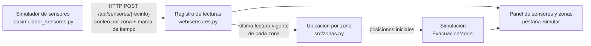

# IoT: de la propuesta al prototipo

El proyecto declara tres pilares de Industria 4.0: **simulación** (el modelo y
la app web), **big data y análisis** (las corridas Monte Carlo y la comparación
de recintos) e **IoT**. Este tercero tiene hoy un **prototipo funcional con
sensores simulados**: un sensor informa cuánta gente cuenta en cada sector del
recinto, la API guarda esas lecturas y la simulación puede arrancar con esa
ocupación en lugar de ubicar a la gente al azar.

Lo que **no** hay son sensores físicos, un broker MQTT ni una base de datos de
series de tiempo: eso sigue siendo propuesta (ver la sección 4). Este documento
separa con cuidado lo implementado de lo que no.

## 1. La idea

En un evento real, cuánta gente hay y dónde está se puede medir. Si sensores en
el recinto alimentan al modelo, la simulación funciona como un **gemelo
digital**: una copia del recinto que arranca con el estado real y permite
preguntar "si hubiera que evacuar ahora, ¿cuánto tardaríamos y dónde se
amontonaría la gente?".

## 2. Qué está implementado



| Pieza | Qué hace | Dónde está |
|---|---|---|
| Zonas | Parte el recinto en sectores con nombre (A1, B1, A2...) y traduce un conteo por sector a celdas concretas. | `src/zonas.py` |
| Sensor simulado (programa aparte) | Hace de gateway: pregunta las zonas a la API y envía conteos plausibles cada pocos segundos, por la red. | `iot/simulador_sensores.py` |
| Sensor simulado (botón) | Lo mismo, pero corriendo dentro del servidor y con un botón en la pantalla; es la forma cómoda para la demo. | `web/generador_sensores.py` |
| Ingesta | Recibe las lecturas, guarda la última de cada zona y decide si el sensor sigue activo. | `web/sensores.py`, rutas en `web/app.py` |
| Simulación | Acepta posiciones iniciales exactas en vez de elegirlas al azar. | `src/model.py` (`posiciones_iniciales`) |
| Pantalla | Muestra el estado de cada sensor, dibuja las zonas sobre el plano y permite elegir que la gente salga "Medida por los sensores". | pestaña Simular (`web/static/js/simulacion.js`) |

Decisiones que vale la pena poder explicar:

- **Los sensores cuentan zonas, no coordenadas.** Un contador real dice "el
  sector B1 tiene 12 personas", no dónde está cada una. Por eso la simulación
  reparte esa gente al azar entre las celdas de la zona (con una semilla, así
  que se repite), sin pretender saber más de lo que midió el sensor.
- **Una lectura caduca.** Si una zona lleva más de 30 segundos sin reportar,
  pasa a **SIN SEÑAL** y deja de usarse para simular. No se inventa gente en una
  zona de la que no se sabe cuánta hay (un sensor roto o sin red es un caso
  normal). La antigüedad se mide con el reloj del servidor, porque el del sensor
  puede estar desfasado.
- **Solo se cuenta.** Los datos son conteos por zona: nada identifica a una
  persona.
- **Si no entra, se avisa.** Si un sensor informa más gente de la que cabe en su
  zona (o en celdas con camino a una salida), se ubican las que entran y la
  respuesta lo indica.

## 3. Cómo probarlo

### Con el botón (lo más simple)

Con el servidor andando (`venv/bin/uvicorn web.app:app --port 8000`), en
`http://localhost:8000`, pestaña **Simular**, elegí un recinto guardado (por
ejemplo `sala_con_puerta`). El panel *Sensores de ocupación* es opcional y tiene
dos pasos:

1. **Encender los sensores.** Apretá **Iniciar sensores simulados**. Se puede
   elegir cuánta gente fingen contar (por defecto, la del slider "Cantidad de
   peatones"), si está repartida pareja o concentrada, y si un sensor debe
   fallar. El panel muestra cada zona, cuántas personas cuenta, hace cuánto
   reportó y su estado, y el plano muestra las zonas con su conteo.
2. **Elegir de dónde sale la gente.** *Al azar, según el slider* es lo de
   siempre. *Medida por los sensores* reinicia la simulación con esa gente en
   cada zona (la cantidad de peatones la dan los sensores, no el slider). Esta
   opción está bloqueada hasta que haya sensores activos.

Con **Apagar sensores simulados** dejan de llegar lecturas, y las zonas pasan
solas a SIN SEÑAL a los 30 segundos.

Un detalle que confunde: el campo "Personas que hay en el recinto" **no es de la
simulación**, es de los sensores falsos. En un recinto real nadie lo elige:
sería la gente que entró, y los sensores la contarían. Como acá no hay sensores
de verdad, el sensor simulado necesita que le digan cuánta gente fingir.

### Con el programa aparte (como un gateway real)

El botón corre los sensores dentro del servidor. Para mostrar cómo sería con un
dispositivo externo que le habla a la API por la red, hay un programa aparte.
En otra terminal, con el servidor andando:

```bash
venv/bin/python -m iot.simulador_sensores --recinto sala_con_puerta
```

Opciones útiles del simulador:

| Opción | Para qué sirve |
|---|---|
| `--total 60` | Cuánta gente hay en el recinto. |
| `--columnas 3 --filas 2` | Cómo se divide el recinto en zonas. |
| `--escenario concentrado --zona-llena B1` | Una zona mucho más llena que las otras. |
| `--falla C2:10` | El sensor de C2 deja de reportar tras 10 envíos: la zona pasa a SIN SEÑAL y se deja de usar. |
| `--intervalo 1` | Segundos entre envíos. |

El formato del mensaje que recibe la API (`POST /api/sensores/{recinto}`) es
este, y se puede probar a mano desde `http://localhost:8000/api/docs`:

```json
{
  "columnas": 3,
  "filas": 2,
  "lecturas": [
    {"sensor": "sensor-a1", "zona": "A1", "personas": 6, "momento": "2026-11-05T20:31:07+00:00"}
  ]
}
```

## 4. Qué sigue siendo propuesta

| Capa | Propuesta original | Prototipo actual |
|---|---|---|
| Sensores | Contadores en los accesos, cámaras o sensores de presencia | Un script que simula conteos |
| Mensajería | MQTT con un broker (por ejemplo Mosquitto) | HTTP directo a la API |
| Ingesta | Base de datos de series de tiempo | La memoria del servidor: solo la última lectura de cada zona (se pierde al reiniciar) |
| Simulador | Usa el último estado conocido como punto de partida | **Implementado** |
| Salida | Dashboard y alertas | **Implementado** como panel en la pestaña Simular (sin alertas) |

Se usó HTTP en lugar de MQTT porque alcanza para demostrar el flujo completo
sensor, ingesta, simulación y visualización sin instalar un broker; el diseño de
capas es el mismo y cambiar el transporte no toca el resto.

## 5. Qué dato alimenta qué parte del modelo

| Dato del sensor | Parámetro del modelo | ¿Está soportado? |
|---|---|---|
| Cuánta gente hay en cada zona | Posiciones iniciales | **Sí** (zonas en grilla) |
| Personas dentro del recinto | `num_agentes` | **Sí**: es la suma de las zonas con sensor activo |
| Planta real del recinto | `ancho`, `alto`, `salidas`, `muros` | **Sí**: el recinto lo define el usuario (texto, dibujo o editor) |
| Estado de una puerta (abierta o cerrada) | `salidas` / `muros` | Parcial: se pueden pasar al crear el modelo, pero no cambiarlas durante la corrida |
| Entrada de gente a lo largo del tiempo | — | No: todos los peatones existen desde el paso 0 |

## 6. Límites y cuidados

- **El prototipo no autentica a los dispositivos.** Cualquiera que llegue a la
  API puede enviar lecturas. Un sistema real necesitaría identificar a cada
  sensor y validar los mensajes antes de usarlos.
- **No hay persistencia.** Al reiniciar el servidor se pierden las lecturas (los
  sensores vuelven a reportar solos).
- **Calidad del dato.** Los sensores de conteo se descalibran y pierden
  mensajes; por eso las lecturas caducan y las zonas sin señal no se usan. Un
  contador descalibrado, en cambio, no se detecta.
- **Los datos son simulados.** Lo que se demuestra es la arquitectura y el flujo,
  no la precisión de ningún sensor real.
- **Validez de la predicción.** El simulador no está calibrado con evacuaciones
  reales (ver las limitaciones en el [marco teórico](marco_teorico.md)). Sus
  resultados sirven para **comparar configuraciones**, no como pronóstico exacto
  de tiempos.

## 7. Próximos pasos posibles

- Reemplazar HTTP por MQTT con un broker local (Mosquitto) y un consumidor que
  alimente la API.
- Guardar las lecturas con su marca de tiempo (SQLite o una base de series de
  tiempo) y graficar la ocupación a lo largo del tiempo.
- Poder cerrar o abrir una salida durante la corrida (convertir esa celda en muro
  y recalcular el *floor field*), alimentado por un sensor de puerta.
- Modelar la entrada de gente al recinto a lo largo del tiempo.
- Autenticar los sensores (por ejemplo con una clave por dispositivo).
